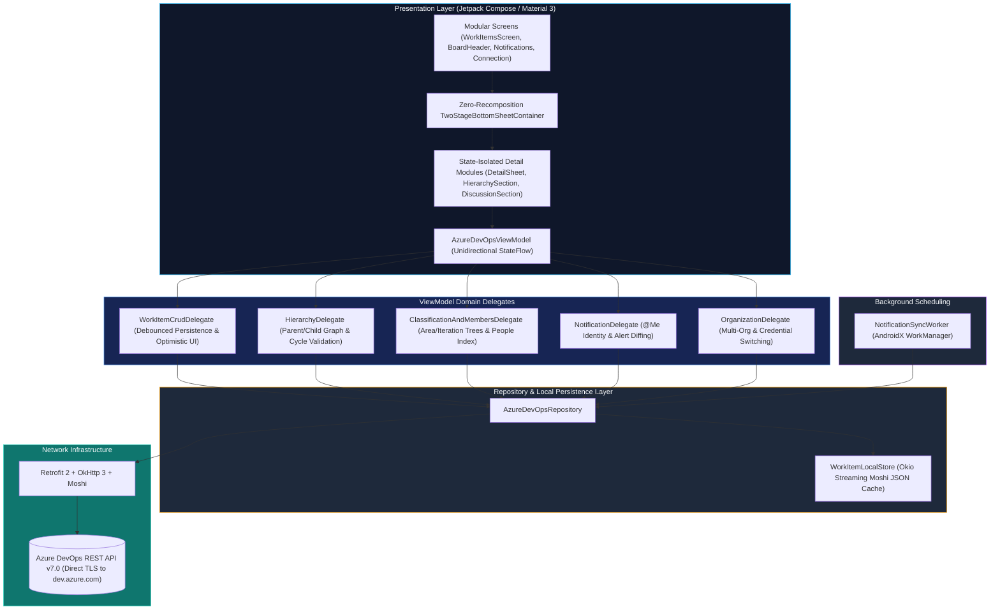

<div align="center">

  <h1>Azure Boards for Android</h1>

  <p>
    <strong>A high-performance, privacy-focused native Android client for Microsoft Azure Boards.</strong><br>
    Stop suffering through sluggish mobile web views, desktop-only layouts, and missed assignment emails. Experience instant 60fps backlog management, ergonomic two-stage detail sheets, and native push notifications on your device.
  </p>

  <!-- UNIFIED SHIELDS.IO BADGES -->
  <p>
    
    <a href="https://developer.android.com"></a>
    <a href="https://kotlinlang.org"></a>
    <a href="https://developer.android.com/jetpack/compose"></a>
    <a href="https://learn.microsoft.com/en-us/rest/api/azure/devops/"></a>
    <a href="./LICENSE"></a>
  </p>

  <!-- QUICK ACTION BAR -->
  <h4>
    <a href="#-get-the-app">Get the App</a>
    <span> • </span>
    <a href="#-why-this-app">Why This App</a>
    <span> • </span>
    <a href="#-features">Features</a>
    <span> • </span>
    <a href="#-architecture">Architecture</a>
    <span> • </span>
    <a href="#-security--permissions">Privacy & Security</a>
    <span> • </span>
    <a href="#-building-from-source">Build from Source</a>
  </h4>

</div>

---

## 💡 Why This App?

Most mobile workflows for **Azure Boards** rely on desktop-oriented browser views or clunky hybrid wrappers that lose scroll position, lag while typing, and fail to deliver real-time alerts. Here is how **Azure Boards for Android** compares:

| Capability / Metric | Azure Boards (Native Android) | Azure DevOps Mobile Web | Generic Third-Party Wrappers |
| :--- | :---: | :---: | :---: |
| **User Interface** | **100% Native (Jetpack Compose / Material 3)** | Desktop HTML/JS (Cramped & Laggy) | Hybrid / WebView Wrapper |
| **Cold Start Time** | **< 100ms** (Instant Local Snapshot) | 3,000ms – 7,000ms | 1,500ms – 3,000ms |
| **Detail Sheet Ergonomics** | **Two-Stage Sheet + Upper-Screen Swipe Dismiss** | Full-page reload (loses board context) | Rigid modal screens |
| **Hierarchy Navigation** | **In-Sheet Parent/Child Stack & Cycle Checks** | Multi-tab browser juggling | Flat lists or read-only links |
| **System Push Alerts** | ✅ Native OS Notification Channels (`@Me`) | ❌ None (Requires Email rules) | ⚠️ Delayed / Cloud-relay dependent |
| **Offline Usability** | ✅ Instant Local Snapshot & Optimistic Edits | ❌ Completely Broken Offline | ⚠️ Read-only |
| **Credential Storage** | 🔒 Device-Local Storage (Direct PAT Auth) | Browser Cookies (Frequent Re-login) | Third-party Cloud Relay |
| **Data Tracking** | 🛡️ **Zero Telemetry / Direct TLS API Only** | Heavy Web Analytics Beacons | Third-party Ad & Analytics SDKs |

---

## ✨ Features

### ⚡ 60fps Fluid Performance & Modular Compose Architecture
- **Zero-Recomposition Sheet Gestures**: Dragging and backdrop dimming run purely in Compose's Layout and Draw phases (`Modifier.offset` & `Modifier.graphicsLayer`), eliminating full-screen recompositions during touch gestures.
- **Zero-Jank Backlog Scrolling & On-Demand Heap Footprint**: `WorkItem` domain models evaluate normalized lowercase area/iteration paths and tags lazily (`LazyThreadSafetyMode.NONE`) and compute lowercase descriptions on demand (`get()`), while `WorkItemHierarchyDelegate` memoizes process state lookups in a thread-safe `ConcurrentHashMap` and `WorkItemsScreen` hoists fallback state lists outside `LazyColumn` items to eliminate per-card allocations during fast scrolling.
- **State-Isolated Detail Subcomponents**: Title editing, Description editing, Metadata pills, Tags, Hierarchy management, and Discussion comments operate in isolated state scopes with `320ms–400ms` debounced persistence—keeping typing instantaneous even on work items with large histories.
- **Offloaded Concurrency**: Multi-dimensional filtering, regex matching, and hierarchy tree construction execute on `Dispatchers.Default` with conflated batch streaming.

### 🪄 Two-Stage Animated Work Item Detail Sheet
- **Stage 1 (Preview) to Stage 2 (Full Screen)**: Tapping a work item opens a smooth half-screen preview (`62%` height). Scrolling upward expands the sheet seamlessly to full height and hands residual scroll momentum directly to the content list.
- **Locked Content Scrolling & Upper-Screen Swipe Dismissal**: Once fully expanded, touches starting in the lower two-thirds of the screen are strictly locked to content scrolling so you never accidentally pull the sheet down while reading. Swiping down from the upper one-third (including the upper `1/4`) of the screen or tapping `<` (Back) / `X` (Close) smoothly dismisses the sheet.
- **Keyboard-Aware Auto-Expansion**: Focusing **Description** or **Discussion Comment** automatically expands the sheet to full height, locks it against collapse while the software keyboard is open, and scrolls the active input field above the keyboard.

### 🌳 Full Backlog Hierarchy & In-Sheet Navigation Stack
- **Complete Process Template Support**: Browse and manage Portfolio Backlogs (*Epics*, *Features*), Requirement Backlogs (*User Stories*, *Product Backlog Items*), and Iteration Backlogs (*Tasks*, *Bugs*) with official Azure Boards iconography and color tokens.
- **In-Sheet Hierarchy History Stack**: Tap any linked Parent or Child row inside the Detail sheet to inspect and edit it in place, then press the top-left **Back** button (or system back gesture) to return to the previous work item with all updates reflected live, or tap **Close (`X`)** to dismiss the sheet immediately.
- **Parent & Child Link Management**: Link existing work items by ID or keyword, create new linked Parent/Child items of valid process types, replace an existing parent with confirmation, or unlink relations (`System.LinkTypes.Hierarchy-Reverse` / `Hierarchy-Forward`) with automated cycle and ancestor validation.

### 🔍 Multi-Dimensional Filtering & Instant Search
- **Debounced Keyword & Numeric ID Search**: Filter work items by title, numeric ID (`#123`), description, tags, or assignee with adaptive `180ms` search debouncing during rapid typing and instant `0ms` reset when cleared.
- **Backlog-Ordered Type & State Filters**: Filter by Work Item Type (automatically ordered from highest backlog level to lowest) and State (*Proposed*, *Active/In Progress*, *Resolved*, *Closed/Done*, *Removed*).
- **Interactive Area & Iteration Tree Pickers**: Navigate deeply nested Area Paths and Iteration Paths (`Project\Team\Sprint`) via expandable tree dialogs.
- **Assignee Autocomplete**: Filter by team member or specifically isolate **Unassigned** work items.

### 💬 Discussions & Floating `@Mention` Autocomplete
- **Chronological Discussion Feed**: Read and post work item comments with HTML rendering, clickable links, highlighted `@mentions`, and automatic RTL/Persian text alignment.
- **Above-Keyboard `@Mention` Bar**: Typing `@` in a comment surfaces a floating suggestion bar docked above the keyboard with team member avatars, display names, and email previews powered by a precomputed people index.

### 🔔 Smart Notifications Center & System Push Alerts
- **Assigned & Mentioned Feeds**: Dedicated Notifications screen displaying the 10 most recent work items **Assigned** to you and the 10 most recent comments where you were **@Mentioned**.
- **Zero-Configuration Identity Discovery**: Automatically resolves your Azure DevOps profile from your Personal Access Token (PAT) and runs native `@Me` WIQL queries.
- **Native Push Channels & Deep-Linking**: Periodic background sync via AndroidX `WorkManager` posts notifications to dedicated Android 13+ channels (**Assigned Work Items** and **Discussion Mentions**). Tapping any system alert deep-links directly into that work item's Detail sheet.

### 🏢 Multi-Organization Support & Instant Cold Starts
- **Multi-Organization Switcher**: Connect multiple Azure DevOps organizations with independent PAT credentials, switch active organizations in a single tap, and configure default organization and project startup preferences.
- **Offline Snapshot Cache**: Atomic file-based JSON snapshots (`WorkItemLocalStore`) use Okio buffered streaming (`BufferedSink` / `BufferedSource`) with Moshi to persist and restore your projects, work items, classification trees, and notifications without intermediate heap string allocations.

---

## 🏗️ Architecture

Engineered with **Clean Architecture**, **MVVM**, and **Modular Delegate Isolation**:



### Modular Package Structure

```text
app/src/main/java/com/example/
├── data/
│   ├── api/                 # Retrofit interfaces, Basic PAT auth interceptor & REST client
│   ├── local/               # Atomic file-based JSON snapshot persistence & preferences
│   ├── model/               # @Immutable Moshi-serializable domain models & WIQL payloads
│   └── repository/          # Unified repository, batch hydration & notification sync
├── notifications/           # Android 13+ notification channels, push helper & WorkManager worker
├── ui/
│   ├── components/
│   │   ├── TwoStageBottomSheetContainer.kt  # Layout-phase two-stage sheet & upper-zone swipe dismiss
│   │   ├── WorkItemDetailSheet.kt           # State-isolated detail view & debounced field editors
│   │   ├── WorkItemHierarchySection.kt      # Parent/Child section & 7 hierarchy linking dialogs
│   │   ├── WorkItemDiscussionSection.kt     # Comment composer, @mention bar & discussion feed
│   │   ├── WorkItemCreateSheet.kt           # New work item creation sheet
│   │   ├── WorkItemPickerDialogs.kt         # Assignee, Tag & Area/Iteration tree pickers
│   │   ├── WorkItemMentionComponents.kt     # Indexed @mention tokenizer & suggestion chips
│   │   └── WorkItemSharedAtoms.kt           # WorkItemCard, type symbols, status rows & helpers
│   ├── screens/
│   │   ├── WorkItemsScreen.kt               # Main backlog board & detail navigation backstack
│   │   ├── WorkItemsBoardHeader.kt          # Organization header, filter capsules & inline search
│   │   ├── NotificationsScreen.kt           # Assigned & @Mentioned activity center
│   │   ├── ConnectionScreen.kt              # PAT onboarding & organization connection flow
│   │   └── SettingsDialog.kt                # Multi-org management & startup preferences
│   ├── theme/               # Material 3 theme, typography & official Azure Boards color tokens
│   └── viewmodel/           # AzureDevOpsViewModel & focused domain delegates
└── MainActivity.kt          # Edge-to-edge entry point & notification deep-link intent handler
```

---

## 📥 Get the App

### Pre-Compiled Release Status
> [!IMPORTANT]
> **No pre-compiled APK has been released yet.** We are actively finalizing our initial milestone before publishing signed binaries to GitHub Releases.

Until the first official APK is published under **Releases**, please build and install the application directly from source using the steps in [Building from Source](#-building-from-source).

---

## 🔒 Security & Permissions

Transparency is essential for developer tools that handle workspace credentials. Here is every permission requested in `AndroidManifest.xml` and why:

| Permission | Necessity | Purpose |
| :--- | :---: | :--- |
| `android.permission.INTERNET` | Mandatory | Direct encrypted TLS communication with official Azure DevOps REST APIs (`https://dev.azure.com/{organization}/_apis/...`). |
| `android.permission.ACCESS_NETWORK_STATE` | Mandatory | Detects connectivity changes to fall back gracefully to local snapshots and constrain background sync. |
| `android.permission.POST_NOTIFICATIONS` | Optional | Delivers system push alerts on Android 13+ for work item assignments and `@mentions` (can be declined or disabled at any time). |

> [!NOTE]
> - **Hardware-Backed Credential Storage**: Your Personal Access Token (PAT) is encrypted with AES-256-GCM via the Android Keystore (`EncryptedTokenStore`) without silent plaintext downgrades on device, and cached work item snapshots are stored strictly inside your device's private application sandbox (`Context.filesDir`).
> - **Hardened Input & Session Lifecycle**: PAT inputs exclude `onSaveInstanceState` serialization, disable IME autocorrect, mark clipboard copies with `ClipDescription.EXTRA_IS_SENSITIVE`, and evict in-memory SHA-256 keyed Retrofit clients and local caches upon sign-out.
> - **Strict Organization Sanitization & Zero Release Logging**: Organization names and URLs (`dev.azure.com/{org}` and `{org}.visualstudio.com`) are strictly sanitized and validated against `^[a-zA-Z0-9][a-zA-Z0-9-]{0,62}$` to block path traversal or URL injection, and OkHttp request logging is restricted strictly to debug builds (`BuildConfig.DEBUG`). Credentials never pass through any intermediate proxy or third-party server.

---

## 🛠️ Building from Source

### Prerequisites
- **Android Studio** Ladybug (2024.2+) or newer
- **JDK 17** or **JDK 21**
- **Android SDK** API 36 (minSdk 24 / Android 7.0+)
- An **Azure DevOps Personal Access Token (PAT)** with:
  - **Work Items**: `Read & write`
  - **Project and Team**: `Read`

### Build & Install Steps

```bash
# 1. Clone the repository
git clone https://github.com/your-username/azure-boards-android.git
cd azure-boards-android

# 2. Compile Debug APK
gradle assembleDebug

# 3. Run unit & Robolectric tests
gradle :app:testDebugUnitTest
```

### First-Launch Setup
1. Launch **Azure Boards** on your Android device or emulator.
2. Enter your **Azure DevOps Organization** name (e.g., `my-org` or `https://dev.azure.com/my-org`).
3. Paste your **Personal Access Token (PAT)**.
4. Enable **Remember credentials on this device** and tap **Connect**.

---

## ❓ Frequently Asked Questions

<details>
<summary><b>Does this application collect personal data or telemetry?</b></summary>
<br>
No. The application is completely telemetry-free. There are no analytics SDKs, crash-reporting beacons, or advertising trackers embedded in the codebase. All network requests go directly from your device to <code>dev.azure.com</code>.
</details>

<details>
<summary><b>How does the two-stage Detail bottom sheet gesture work?</b></summary>
<br>
When you tap a work item, the Detail sheet opens in <b>Stage 1 (preview)</b>. Scrolling up expands the sheet to <b>Stage 2 (full screen)</b>. Once fully expanded, scrolling anywhere in the lower two-thirds of the screen scrolls only the work item content so the sheet never accidentally collapses. To close the expanded sheet, swipe down from the upper one-third (or upper quarter) of your screen, or tap the <code>&lt;</code> (Back) or <code>X</code> (Close) button.
</details>

<details>
<summary><b>How does background synchronization impact battery life?</b></summary>
<br>
Background notification checks are scheduled through AndroidX <code>WorkManager</code> with network connectivity constraints. The app respects Android Doze Mode and never holds persistent wake locks.
</details>

<details>
<summary><b>Why is there no APK download link yet?</b></summary>
<br>
We have not cut our first public APK release yet. Once the initial release is tagged, a direct APK download badge and signed release binary will be published in the repository's Releases section.
</details>

---

## 🤝 Contributing

Contributions, bug reports, and feature requests are welcome! Feel free to open an issue or submit a pull request for review.

---

## 📄 License

Distributed under the **MIT License**. See [`LICENSE`](./LICENSE) for more information.
