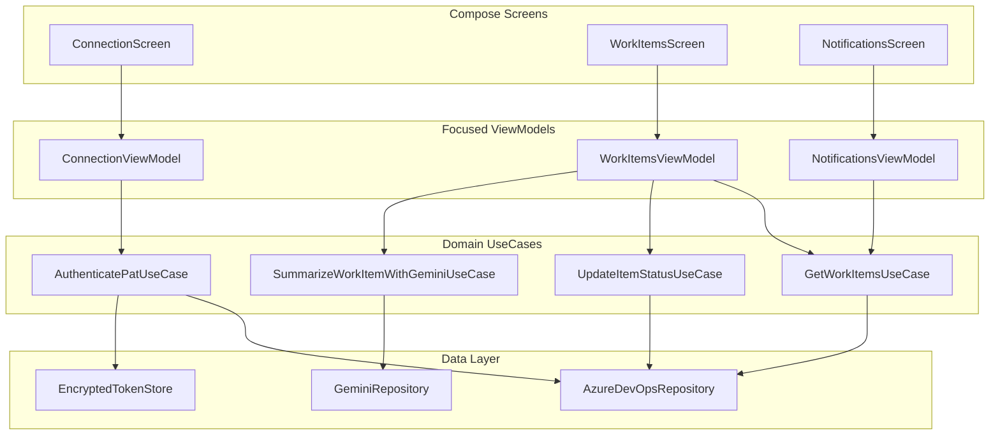

### 1. Refactor the Monolithic ViewModel (`AzureDevOpsViewModel.kt`)

Currently, `AzureDevOpsViewModel.kt` is **~3,560 lines** of mixed responsibilities. 

#### Recommended Architecture: MVI / Clean MVVM
Break it down into focused ViewModels and clean domain Use Cases:



1. **Extract State into UI States**:
   * Replace individual mutable fields with sealed UI state interfaces:
   ```kotlin
   sealed interface WorkItemsUiState {
       data object Loading : WorkItemsUiState
       data class Success(val items: List<WorkItem>, val filter: WorkItemFilter) : WorkItemsUiState
       data class Error(val message: String) : WorkItemsUiState
   }
   ```
2. **Move Polling / Background Sync into WorkManager**:
   * Instead of keeping polling jobs inside the ViewModel's `viewModelScope` with while-loops, use Android's **`WorkManager`** (`CoroutineWorker`) for background notification checks and status sync. This survives app kills and respects battery optimization.

---

### 2. Integrate Google AI Studio (Gemini) Capabilities

The project already has the `secrets-gradle-plugin` configured in `app/build.gradle.kts`. You can add smart AI features to Azure Boards:

1. **Add the Google GenAI SDK** (in `gradle/libs.versions.toml`):
   ```toml
   [libraries]
   google-generativeai = { group = "com.google.ai.client.generativeai", name = "generativeai", version = "0.9.0" }
   ```
2. **Key AI Use Cases for Azure Boards Mobile**:
   * **Work Item Summarization**: Auto-summarize long discussion threads and history in work items.
   * **Smart Acceptance Criteria Generator**: Generate testable criteria when creating a bug or user story on mobile.
   * **Standup / Sprint Digest**: Generate a quick daily briefing of assigned tasks directly in the notification or home screen.

---

### 3. Add Dependency Injection (Hilt or Koin)

The current code manually instantiates dependencies:
```kotlin
// Currently in AzureDevOpsViewModel:
private val repository = AzureDevOpsRepository(application.applicationContext)
```

**Recommendation**: Add **Hilt** or **Koin**:
- Eliminates manual passing of `Context` to repositories.
- Allows you to mock network and repository layers during Robolectric and Compose UI tests without complex test setup.

---

### 4. Enable Type-Safe Navigation

You already have `navigationCompose = "2.8.9"` defined in `libs.versions.toml`.

Replace root `Crossfade` / `if (connectionStatus ...)` in `MainActivity.kt` with **Type-Safe Compose Destinations**:
```kotlin
@Serializable object ConnectionDestination
@Serializable data class WorkItemDetailDestination(val itemId: Int)
@Serializable object NotificationsDestination

NavHost(navController = navController, startDestination = ConnectionDestination) {
    composable<ConnectionDestination> { ConnectionScreen(...) }
    composable<WorkItemDetailDestination> { backStackEntry ->
        val detail: WorkItemDetailDestination = backStackEntry.toRoute()
        WorkItemDetailScreen(itemId = detail.itemId)
    }
}
```

---

### Summary of Priority Actions

| Priority | Task | Benefit |
| :--- | :--- | :--- |
| **High** | Split `AzureDevOpsViewModel.kt` into 3-4 feature ViewModels | Eliminates the 3,500-line god class; speeds up compile times and testing. |
| **High** | Replace plain storage with `EncryptedSharedPreferences` / DataStore | Protects Azure DevOps Personal Access Tokens (PAT). |
| **Medium** | Introduce Hilt / Koin DI | Clean architecture, removes singleton/direct context leaks. |
| **Medium** | Connect Gemini SDK for Work Item summaries | Brings Google AI Studio features directly to mobile work tracking. |